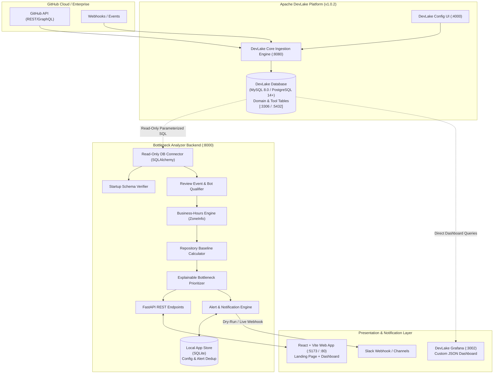
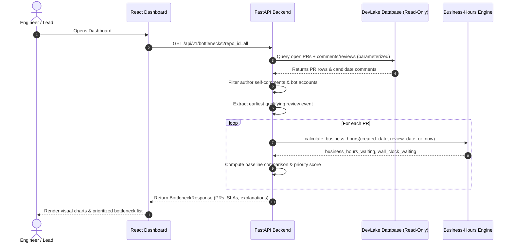
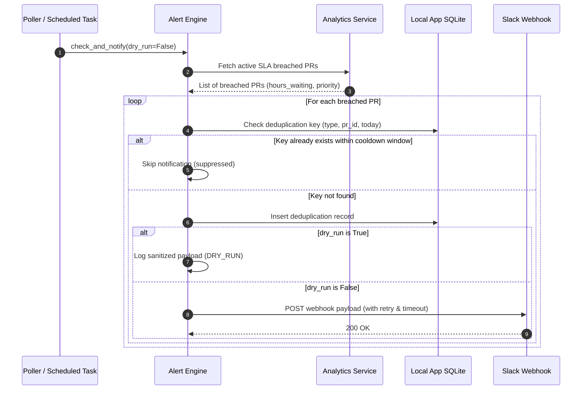

# System Architecture & Technical Design

**Project:** Engineering Delivery Bottleneck Analyzer  
**Upstream System:** Apache DevLake (`v1.0.2`)  
**Architecture Pattern:** Non-Invasive Analytical Companion / Sidecar  

---

## 1. High-Level Architecture Overview

The **Engineering Delivery Bottleneck Analyzer** operates as an independent companion to **Apache DevLake**. DevLake handles the heavy lifting of authentication, GitHub token rate limiting, webhook/REST/GraphQL polling, and data normalization into standardized domain tables. 

Our analyzer connects directly to DevLake's relational database via **parameterized, read-only SQL queries**, computes context-aware metrics (business-hours SLA, bot-filtered review detection, baseline comparison, and explainable prioritization), serves these metrics through a high-performance **FastAPI REST API**, and renders them in an intuitive **React + Vite** dashboard and a **portable Grafana dashboard**.

---

## 2. Component Breakdown & Responsibilities

### 2.1 Upstream Platform Components (DevLake)
1. **Config UI (`:4000`):** Manages GitHub personal access tokens (PATs), repository sync scopes, and pipeline scheduling.
2. **Ingestion Engine (`:8080`):** Handles API pagination, incremental syncing, and domain table population.
3. **Database (`:3306` or `:5432`):** Houses the `pull_requests`, `pull_request_comments`, `repos`, and tool-layer tables.

### 2.2 Analyzer Backend Components (`backend/`)
1. **Startup Schema Verifier (`app.database.schema_checker`):**
   - Inspects the connected database before executing metric queries.
   - Validates existence of tables (`pull_requests`, `pull_request_comments`, `repos`) and required columns.
   - Gracefully reports version mismatch or missing tables with actionable setup instructions.
2. **Read-Only Database Connector (`app.database.devlake_session`):**
   - Configured with strict read-only session flags (`SET SESSION TRANSACTION READ ONLY` where supported).
   - Uses parameterized queries to prevent SQL injection.
3. **Review Qualifier & Bot Filter (`app.analytics.review_detector`):**
   - Extracts the first genuine review event.
   - Enforces author exclusion (`comment.account_id != pr.author_id`).
   - Applies regex bot filters (`[bot]`, `codecov`, `dependabot`, `actions`, `renovate`).
   - Identifies high-confidence review types (`DIFF`, `REVIEW`, `APPROVED`, `CHANGES_REQUESTED`).
4. **Business-Hours Engine (`app.analytics.business_hours`):**
   - Built on Python's native `zoneinfo` and `datetime`.
   - Computes minute-accurate business-time delta between timestamps.
   - Configurable timezone (default: `Asia/Kolkata`), working days (`Mon-Fri`), work hours (`09:30-18:30`), and holiday calendar.
   - Handles Daylight Saving Time (DST) transitions safely without timestamp ambiguity.
5. **Repository Baseline Calculator (`app.analytics.baselines`):**
   - Calculates historical median and P90 review pickup times per repository.
   - Enforces a minimum sample size (`min_sample_size >= 10`).
   - Emits transparent `INSUFFICIENT_SAMPLE` state when data is scarce.
6. **Explainable Bottleneck Prioritizer (`app.analytics.prioritizer`):**
   - Generates an urgency score (0 to 100) based on:
     - SLA breach severity (0-40 points)
     - PR state & review readiness (0-20 points)
     - Historical baseline deviation (0-20 points)
     - PR size & review effort (0-10 points)
     - Repository backlog pressure (0-10 points)
   - Emits a full array of rationale explanations for each score.
7. **Alert Engine & Deduplicator (`app.notifications`):**
   - Evaluates active SLA breaches and backlog spikes.
   - Maintains an isolated SQLite database (`data/app_state.db`) for deduplication keys: `(alert_type, pr_id_or_repo_id, date)`.
   - Supports safe dry-run mode (logs sanitized JSON payload without calling external networks).
   - Enforces automatic token/webhook redaction.
8. **Synthetic Demo Seed Generator (`app.fixtures`):**
   - Generates realistic, clearly labeled synthetic test fixtures for offline development and demonstration without a live GitHub or DevLake connection.

### 2.3 Presentation Layer Components (`frontend/`)
1. **Public Landing Page:**
   - One-minute architectural pitch for recruiters, engineering managers, and developers.
   - Clear problem statement, DevLake integration summary, and feature differentiators.
   - Technology stack display and zero-cloud local quickstart instructions.
2. **Main Analytics Dashboard:**
   - Real-time SLA breach summary cards.
   - Wall-clock vs Business-hours comparative analysis chart.
   - Prioritized bottleneck table with expandable scoring explanations.
   - Repository-level comparative metrics.
   - Backlog trend graph.
   - Demonstration mode toggle banner.
3. **Portable Grafana Dashboard (`dashboards/grafana-pr-bottlenecks.json`):**
   - Compatible with DevLake's built-in Grafana instance.
   - Parameterized by `$repo_id` and `$__timeFilter`.

---

## 3. Data Flow & Lifecycles

### 3.1 Review Latency Calculation Flow

### 3.2 Alert & Deduplication Flow

---

## 4. Security & Isolation Architecture

1. **Read-Only Ingestion Boundary:**  
   The analyzer connects using read-only database credentials. It possesses no `CREATE`, `DROP`, `ALTER`, `INSERT`, or `UPDATE` privileges on DevLake tables.
2. **Isolated Configuration Store:**  
   All analyzer configuration, alert deduplication keys, and notification logs reside in a dedicated local SQLite file (`data/app_state.db`), preventing accidental mutation of DevLake's data models.
3. **No Credential Leakage:**  
   Database connection strings, GitHub tokens, and Slack webhook URLs are loaded strictly from environment variables or a local `.env` file excluded from version control. Sensitive strings are masked in logs (e.g., `https://hooks.slack.com/services/T***/B***/X***`).
4. **Boundary Isolation:**  
   The web dashboard connects to the backend through CORS-restricted APIs and does not receive raw database credentials.
