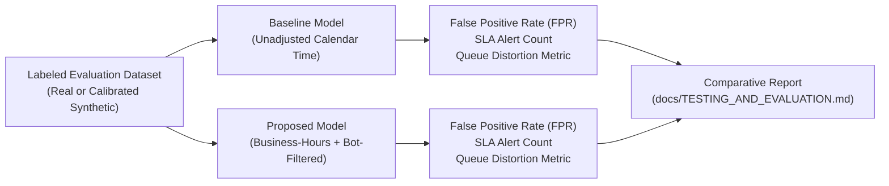

# Research Plan & Empirical Investigation Roadmap

**Project:** Engineering Delivery Bottleneck Analyzer  
**Upstream System:** Apache DevLake (`v1.0.2`)  

---

> [!NOTE]
> **Research Integrity Notice:** This document outlines an empirical evaluation methodology and research direction for code review queue analysis. This project is an open-source engineering tool extending Apache DevLake. We make no claims of patentability, novel algorithmic inventions, academic peer-reviewed publication, or conference acceptance. All hypotheses must be substantiated through controlled experimental evaluation.

---

## 1. Prior Art & Related Work

Modern software engineering research and industry metrics platforms have highlighted that code review latency is frequently the dominant component of software delivery cycle time.

### 1.1 Academic Literature
1. **Rigby & Bird (2013), "Convergent Contemporary Software Peer Review Practices":**  
   Investigated peer review across multiple top open-source and commercial ecosystems (Linux, Apache, KDE, Google). Found that modern code reviews are frequent, small, and asynchronous, with the majority of delay residing in the initial queue waiting time rather than active inspection.
2. **Bacchelli & Bird (2013), "Expectations, Outcomes, and Challenges of Modern Code Review" (ICSE):**  
   Revealed that while developers believe code reviews are primarily for finding defects, knowledge transfer and team awareness are equal drivers. A primary challenge identified was *context switching* and *long wait states* while waiting for initial feedback.
3. **Forsgren, Humble & Kim (2018), "Accelerate: The Science of Lean Software and DevOps" (DORA):**  
   Demonstrated that high-performing engineering organizations maintain tight feedback loops and small batch sizes. Review bottlenecks directly impair Lead Time for Changes (a core DORA metric).
4. **Sadowski et al. (2018), "Modern Code Review: A Case Study at Google":**  
   Documented Google's practice where over 80% of changes receive review feedback in under 4 hours, aided by tooling that promotes small change lists (CLs) and explicit review SLA expectations.

### 1.2 Commercial & Open-Source Tooling
* **Apache DevLake:** Open-source platform standardizing DORA and engineering metrics across tools. Provides retrospective PR Pickup Time and Review Time based on unadjusted calendar time and raw comment counts.
* **LinearB:** Commercial engineering analytics platform that popularizes PR Pickup Time and Review Depth. LinearB emphasizes business-hours adjustments in its enterprise SaaS tier, validating the industry need for this calculation.
* **Faros AI & Jellyfish:** Enterprise engineering intelligence platforms providing executive-level cycle time dashboards and capacity planning.

---

## 2. Research Hypothesis & Problem Formulation

### 2.1 The Core Problem
Unadjusted calendar wall-clock metrics systematically distort code review responsiveness:
1. **False Delay Inflaton:** Reviews submitted across non-working periods (e.g. Friday 6 PM to Monday 9 AM) show ~63 hours of pickup delay in conventional analytics, falsely indicating a dereliction of review duty.
2. **False Fast Pickups:** Immediate automated bot responses (e.g. `codecov[bot]` at $T+45$ seconds) mask true multi-day human reviewer bottlenecks.
3. **Queue Invisibility:** Existing platforms primarily measure retrospective completed PRs, leaving active, stalled pull requests invisible until merged or abandoned.

### 2.2 Hypothesis
* **H1:** Filtering bot interactions and restricting review delay calculations to active business hours significantly reduces false positive SLA alerts compared to unadjusted calendar time.
* **H2:** A multi-factor, explainable bottleneck priority score enables reviewers to identify high-urgency, low-effort PRs faster than chronological sorting.

---

## 3. Repeatable Comparison Methodology

To evaluate H1 and H2 empirically without subjective bias, we define a repeatable benchmark protocol:

### 3.1 Benchmark Metrics
1. **False Positive Alert Count ($FP$):** Number of PRs flagged as SLA breaches whose business-hours waiting time was actually within SLA target.
2. **Mean Pickup Time Distortion ($\Delta_{\text{distort}}$):** Absolute difference in reported average pickup time between calendar wall-clock and business-hours.
3. **Bot Contamination Rate ($C_{\text{bot}}$):** Proportion of PRs where the first recorded pickup was triggered by a bot account rather than a human reviewer.
4. **Execution Overhead:** Latency of the analytical calculation across 1,000 PRs (target: $< 250\text{ ms}$).

---

## 4. Dataset Requirements & Limitations

### 4.1 Requirements for Valid Empirical Assessment
* **Sample Size:** At least 200 pull requests across at least 3 distinct repositories.
* **Event Breadth:** Must include PRs created at varying times (weekday mornings, weekday evenings, Friday afternoons, weekends, and designated public holidays).
* **Identity Grounding:** Must include bot comments (`codecov`, `github-actions`), PR author self-comments, and third-party human reviews.
* **Ground Truth Labels:** Each evaluation PR must be manually or deterministically tagged with its true human review timestamp.

### 4.2 Limitations
* **Public Open-Source vs Private Enterprise:** Open-source projects frequently operate with globally distributed, volunteer contributors outside standardized 09:30-18:30 business schedules. Business-hours SLAs are primarily applicable to collocated or time-zone aligned commercial teams.
* **Holiday Schedules:** Regional holiday calendars vary by team location; cross-geography engineering squads require multi-calendar support.

---

## 5. Potential Future Extensions (Subject to Prior-Art Review)

1. **Multi-Timezone Team Modeling:** Support per-repository or per-team working schedules for distributed global organizations.
2. **Predictive Queue Congestion Modeling:** Explore lightweight statistical forecasting (e.g. ARIMA or Poisson queueing models) to predict when a review backlog will exceed SLA capacity before breaches occur.
3. **Reviewer Load Balancing Recommendations:** Suggest available reviewers based on recent review allocations, subject to team consent and strict safeguards against individual surveillance.
4. **GitLab Merge Request Integration:** Extend the review qualifier to GitLab merge request note types (`DiffNote`, `DiscussionNote`).

